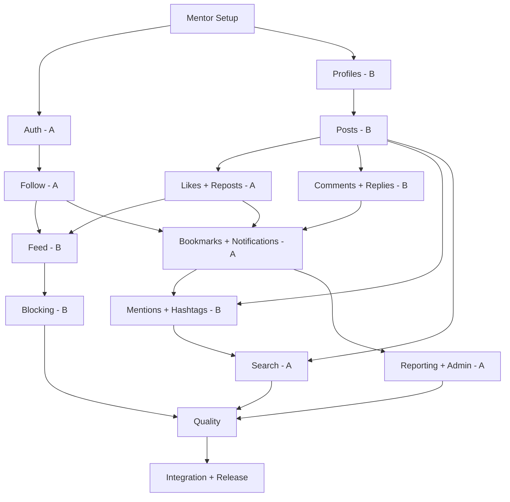
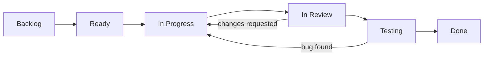
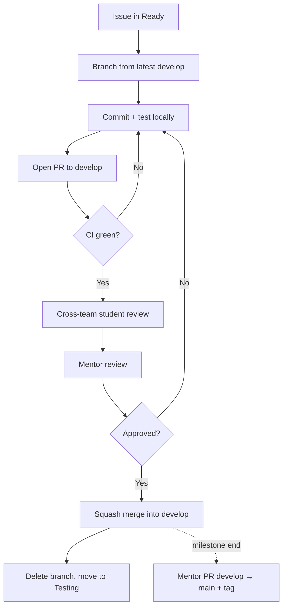
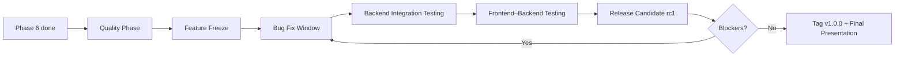

# Chirp — Project Management Plan

*Execution roadmap for 1 mentor + 8 students (Team A, Team B). Source of truth for features, API, schema and architecture: the **Chirp PRD**.*

---

## 1. Plan at a Glance

|  |  |
| --- | --- |
| **Team A** | 4 students (A1–A4) |
| **Team B** | 4 students (B1–B4) |
| **Mentor** | Skeleton, schema, migrations, CI, shared files, PR approval, most of the frontend |
| **Method** | 9 phases → 8 GitHub milestones → 1 demo per phase |
| **Phase length** | Suggested 1–2 weeks each; the plan is dependency-driven, so adjust to your calendar |
| **Rule #1** | Nobody merges into `main`. Ever. |

```mermaid
flowchart LR
    P0[Phase 0<br/>Mentor Setup] --> OB[Onboarding Sprint]
    OB --> P1[Phase 1<br/>Auth ‖ Profiles]
    P1 --> P2[Phase 2<br/>Follow ‖ Posts]
    P2 --> P3[Phase 3<br/>Likes+Reposts ‖ Comments+Replies]
    P3 --> P4[Phase 4<br/>Bookmarks+Notifications ‖ Feed]
    P4 --> P5[Phase 5<br/>Search ‖ Mentions+Hashtags]
    P5 --> P6[Phase 6<br/>Reporting+Admin ‖ Blocking]
    P6 --> P7[Phase 7<br/>Quality]
    P7 --> P8[Phase 8<br/>Integration + Release]
```



---

## 2. Operating Principles (how we avoid chaos)

1. **Module ownership = file ownership.** Each module has its own router, service, schema and test files. Two teams never edit the same file in the same phase.
2. **Mentor owns shared files:** `main.py`, `config.py`, `database.py`, `dependencies/`, `core/`, `models/`, `migrations/`, CI config. Students request changes through an issue.
3. **Mentor pre-creates the whole schema** (all models + one initial migration + empty routers registered in `main.py`). Students build *behaviour*, not tables. A table change needs a `schema-change` issue and mentor approval.
4. **Stub-and-wire pattern.** When feature X needs data from a later feature Y, X's team writes a stub (e.g. `like_count = 0`); Y's team later wires the real query in a small, separate PR reviewed by X's owner. This is how real teams decouple work.
5. **Cross-team review.** Team A reviews Team B and vice-versa, then the mentor approves.
6. **Contracts first.** Request/response shapes come from the PRD API section; any change goes through an `api-contract` issue.

### Module → File Ownership Map

| Module | Router | Service | Schema | Tests |
| --- | --- | --- | --- | --- |
| Auth | `routers/auth.py` | `services/auth_service.py` | `schemas/auth.py` | `tests/test_auth.py` |
| Profiles | `routers/users.py` | `services/user_service.py` | `schemas/user.py` | `tests/test_users.py` |
| Follow | `routers/follows.py` | `services/follow_service.py` | `schemas/follow.py` | `tests/test_follows.py` |
| Posts | `routers/posts.py` | `services/post_service.py` | `schemas/post.py` | `tests/test_posts.py` |
| Comments | `routers/comments.py` | `services/comment_service.py` | `schemas/comment.py` | `tests/test_comments.py` |
| Likes | `routers/likes.py` | `services/like_service.py` | `schemas/like.py` | `tests/test_likes.py` |
| Reposts | `routers/reposts.py` | `services/repost_service.py` | `schemas/repost.py` | `tests/test_reposts.py` |
| Feed | `routers/feed.py` | `services/feed_service.py` | `schemas/feed.py` | `tests/test_feed.py` |
| Bookmarks | `routers/bookmarks.py` | `services/bookmark_service.py` | `schemas/bookmark.py` | `tests/test_bookmarks.py` |
| Notifications | `routers/notifications.py` | `services/notification_service.py` | `schemas/notification.py` | `tests/test_notifications.py` |
| Mentions/Hashtags | `routers/hashtags.py` | `services/mention_service.py`, `hashtag_service.py` | `schemas/hashtag.py` | `tests/test_mentions.py`, `test_hashtags.py` |
| Search | `routers/search.py` | `services/search_service.py` | `schemas/search.py` | `tests/test_search.py` |
| Blocking | `routers/blocks.py` | `services/block_service.py` | `schemas/block.py` | `tests/test_blocks.py` |
| Reporting | `routers/reports.py` | `services/report_service.py` | `schemas/report.py` | `tests/test_reports.py` |
| Admin | `routers/admin.py` | `services/admin_service.py` | `schemas/admin.py` | `tests/test_admin.py` |

*Add a `.github/CODEOWNERS` file mapping these paths to their owners so GitHub requests the right reviewers automatically.*

---

## 3. Phase 0 — Mentor Setup *(mentor only)*

### Goal

Give students a working, boringly reliable starting point: clone → run → green tests.

### Mentor Tasks

| Area | Task | Done |
| --- | --- | --- |
| Repo | Create GitHub repo, `main` + `develop`, `.gitignore`, `CODEOWNERS` | ☐ |
| Protection | Branch protection on `main` and `develop` (see §10) | ☐ |
| Structure | Folder layout from PRD Part E, empty routers registered in `main.py` | ☐ |
| FastAPI | App factory, `GET /health`, CORS config, global exception handlers | ☐ |
| Config | `config.py` (pydantic-settings), `.env.example` | ☐ |
| Database | PostgreSQL setup, dev + test databases, `database.py` session + `get_db` | ☐ |
| Models | SQLAlchemy models for **all** tables in PRD Part C | ☐ |
| Migrations | Alembic configured; initial migration; verified on a fresh DB | ☐ |
| Security | Password hashing helper, JWT create/verify helpers, working `get_current_user` and `require_admin` dependencies | ☐ |
| Testing | pytest, test DB fixtures, `client` and `auth_headers` fixtures | ☐ |
| CI | GitHub Actions: install → lint (`ruff`) → `pytest` on every PR | ☐ |
| Docs | `README.md` (setup in ≤ 10 commands), `CONTRIBUTING.md`, PR + issue templates | ☐ |
| Seed | Script to create an admin user and demo data | ☐ |
| Board | Create GitHub Project board, labels, milestones, and Phase 1 issues | ☐ |

### Dependencies

The Chirp PRD (approved).

### Deliverable

A student can clone the repo, follow the README, run migrations, start the server, open `/docs`, see `/health` return `{"status":"ok"}`, and run `pytest` successfully.

### Review Checklist (self-check, then dry-run)

- [ ] A **fresh machine/folder** setup works using only the README (ask a friend or do a clean clone).
- [ ] `alembic upgrade head` works on an empty DB; `alembic downgrade base` also works.
- [ ] CI is green on a trivial PR; direct pushes to `main`/`develop` are blocked.
- [ ] No secrets in the repo; `.env.example` is complete.

### Demo

Mentor live-clones the repo on a clean folder and gets to `/docs` in under 10 minutes.

**Complexity:** Medium (mentor) · **Learning outcome (students, observing):** what a professional project baseline looks like.

---

## 3.5 Onboarding Sprint *(between Phase 0 and Phase 1; strongly recommended)*

Both teams complete the PRD **First Week Practice** exercises and the **Onboarding Checklist**: clone, venv, `.env`, migrations, run server, branch, commit, push, first PR, and **review a classmate's PR**. Exit rule: *every* student has merged at least one PR into `develop` and reviewed at least one PR. Suggested starter PR: add yourself to `CONTRIBUTORS.md` (this also practices merge-conflict resolution on purpose).

---

## 4. Phase-by-Phase Plan

> **Each phase** runs: *Kickoff (design discussion) → Build → Cross-team review → Mentor approval → Demo Day → Retrospective.* Within each team, split into **two pairs** (e.g. Team A: A1+A2 and A3+A4) so every endpoint has two people who understand it.

---

### PHASE 1 — Authentication & Profiles · Milestone 1

#### Goal

Learn the request → router → service → database flow, hashing, JWT, and the difference between authentication and authorization.

#### Team A — Authentication

- `POST /auth/register` (validation, lowercase email/username, hashing, 409 on duplicates)
- `POST /auth/login` (identifier = email or username, generic 401 message, 403 for deactivated)
- `POST /auth/logout` (204, client-discard semantics documented)
- `PUT /auth/password` (verify current password)
- `POST /auth/deactivate` (re-check password; set `is_active=false`)
- Auth tests: duplicate email, wrong password, expired/invalid token, deactivated login
- Pair split: **A1+A2** register/login · **A3+A4** password/deactivate/logout + tests

#### Team B — User Profiles

- `GET /users/me`, `PATCH /users/me`
- `GET /users/{username}` with `followers_count`, `following_count`, `posts_count` (return **0** for now — stub-and-wire)
- Separate `UserPublic` and `UserMe` schemas; prove `email`/`password_hash` never leak
- Profile tests (uses mentor's token fixture, no dependency on Team A's code)
- Pair split: **B1+B2** read endpoints & schemas · **B3+B4** update endpoint, validation & tests

#### Dependencies

Phase 0 complete (including mentor's `get_current_user`, hashing and JWT helpers).

#### Example GitHub Issues

- `[Feature] Implement user registration` (labels: `feature`, `auth`, `phase-1`)
- `[Feature] Implement login with JWT`
- `[Feature] Change password endpoint`
- `[Feature] Account deactivation`
- `[Feature] View public profile by username`
- `[Feature] Update my profile`
- `[Test] Auth edge cases: expired/malformed token`
- `[Docs] Document auth flow in README`

#### Deliverables

All endpoints above, schemas, tests, Swagger descriptions, README section "How auth works".

#### Review Checklist (mentor)

- [ ] Passwords hashed; no hash/plain text in any response or log
- [ ] Same error message for unknown user and wrong password
- [ ] Identity comes from token, never request body
- [ ] `UserPublic` omits private fields
- [ ] Status codes match PRD (201/200/204/401/403/409/422)
- [ ] Tests cover happy + failure paths; CI green

#### Demo Day

Team A: register → login → copy token into Swagger "Authorize" → call a protected route; show a failing call with a bad token. Team B: edit profile, show public vs private view; each team explains **one design decision** and **one bug** they hit.

**Complexity:** Medium · **Learning outcomes:** hashing, JWT, dependencies, Pydantic validation, response schemas, first PR workflow at speed.

---

### PHASE 2 — Social Graph & Posts · Milestone 2

> *Team roles swap relative to the user's initial suggestion only in module choice, not in the phase pairing: Team A takes Follow, Team B takes Posts. This lets Team A experience many-to-many logic after Team A's auth work and gives Team B the content foundation that Phases 3–5 depend on.*

#### Goal

Learn many-to-many relationships, composite keys, ownership checks, and soft delete.

#### Team A — Follow System

- `PUT /users/{user_id}/follow` (or `POST` — as set by the API contract), `DELETE /users/{user_id}/follow`
- `GET /users/{username}/followers`, `GET /users/{username}/following` (paginated)
- Rules: no self-follow (400), duplicate (409), deactivated target (404/403), unfollow-not-following (404)
- `follow_service.count_followers/count_following` helpers
- Tests: the five core PRD follow scenarios + counts

#### Team B — Posts

- `POST /posts`, `GET /posts/{id}`, `PATCH /posts/{id}`, `DELETE /posts/{id}` (soft delete)
- `GET /users/{username}/posts` (personal posts, paginated, newest first)
- `PostRead` schema with `author`, `like_count`, `comment_count`, `share_count` (all stubbed to 0), `is_edited`
- Shared `Pagination` params (mentor-reviewed first PR, then used by everyone)
- Tests: validation (empty/oversized), 403 on editing others' posts, soft-deleted → 404

#### Dependencies

Phase 1 merged (users exist, auth works). Team A and B touch different files; the only shared point is `UserPublic` counts — wired in the Wiring PR below.

#### Wiring PR (end of phase, small)

Team B replaces the profile's `posts_count` stub using `post_service.count_user_posts`; Team A supplies `followers_count`/`following_count` to the profile (owner of `user_service` = Phase 1 Team B reviews).

#### Example GitHub Issues

- `[Feature] Follow / unfollow user` · `[Feature] List followers and following`
- `[Feature] Create post` · `[Feature] Edit own post` · `[Feature] Soft-delete post`
- `[Feature] Personal posts list`
- `[Refactor] Shared pagination dependency`
- `[Wiring] Profile counts: followers/following/posts`

#### Deliverables

Follow + post endpoints, soft-delete behaviour, counts on profile, tests.

#### Review Checklist

- [ ] `CHECK(follower_id <> following_id)` relied upon *and* validated in code
- [ ] `deleted_at IS NULL` filtered **everywhere** posts are read
- [ ] Ownership enforced on edit/delete; 403 vs 404 chosen consistently
- [ ] Pagination limits capped (max 50)
- [ ] No business logic inside routers

#### Demo Day

Team A: two accounts follow each other, counts update, unfollow, duplicate follow rejected. Team B: create/edit/delete post, show a soft-deleted row in the DB and how the API hides it.

**Complexity:** Medium · **Learning outcomes:** junction tables, constraints, soft delete, authorization vs authentication, stub-and-wire.

---

### PHASE 3 — Interactions: Likes, Reposts, Comments, Replies · Milestone 3

#### Goal

Learn uniqueness constraints, self-referencing tables, and how features attach to existing ones without breaking them.

#### Team A — Likes & Reposts

- `POST/DELETE /posts/{id}/like` (409 duplicate, 404 not liked)
- Optional: `POST/DELETE /comments/{id}/like` (after Team B's comments land)
- `POST/DELETE /posts/{id}/repost` (`UNIQUE(user_id, original_post_id)`, no self-repost, deleted-original check)
- `like_service.get_like_counts(post_ids)` and `repost_service.get_repost_counts(post_ids)` — **bulk** count helpers
- Tests: duplicate like, unlike when not liked, repost rules

#### Team B — Comments & Replies

- `POST /posts/{id}/comments` with optional `parent_comment_id`
- `GET /posts/{id}/comments`, `GET /comments/{id}/replies`
- `PATCH /comments/{id}`, `DELETE /comments/{id}` (author / post owner / admin may delete; only author edits)
- One-level reply rule enforced; parent must belong to the same post
- `comment_service.get_comment_counts(post_ids)` bulk helper
- Tests: reply-to-reply flattening, wrong-post parent, delete permissions

#### Dependencies

Phase 2 (posts exist). Neither team edits `post_service.py` directly.

#### Wiring PRs (end of phase; owner of `post_service`/`PostRead` from Phase 2 Team B reviews)

1. Team A: plug `like_count`, `share_count`, `liked_by_me` into `PostRead`.
2. Team B: plug `comment_count` into `PostRead`. *Do these as **two separate small PRs**, merged sequentially (second one rebases on first).*

#### Example GitHub Issues

- `[Feature] Like and unlike a post` · `[Feature] Repost a post`
- `[Feature] Create comment` · `[Feature] Reply to a comment (1 level)` · `[Feature] Edit/delete comment`
- `[Wiring] Show like/share counts on posts` · `[Wiring] Show comment counts on posts`
- `[Bug] Like count wrong after unlike` *(example of expected bug-report format)*

#### Deliverables

Likes, reposts, comments, replies, counts visible on posts; tests.

#### Review Checklist

- [ ] Duplicate prevention works at the **database** level (IntegrityError handled → 409)
- [ ] Counts use one grouped query per page, not one query per post (no N+1)
- [ ] Reply parent validation (exists, same post, not itself a reply)
- [ ] Soft-deleted posts/comments cannot be liked/commented
- [ ] Permissions table from the PRD implemented exactly

#### Demo Day

Run the like race: fire the same like twice from Swagger; show 201 then 409. Show a thread with a parent comment and two replies; show what happens when the parent is deleted.

**Complexity:** High *(first cross-feature wiring)* · **Learning outcomes:** composite unique constraints, self-reference, IntegrityError handling, N+1 problem, small wiring PRs.

---

### PHASE 4 — Feed, Bookmarks & Notifications · Milestone 4

#### Goal

Learn joins, ordering, pagination, side effects and database transactions.

#### Team A — Bookmarks & Notifications

- Bookmarks: `POST/DELETE /posts/{id}/bookmark`, `GET /bookmarks` (private, paginated, hides deleted posts)
- Notifications: `GET /notifications`, `GET /notifications/unread-count`, `PATCH /notifications/{id}/read`, `POST /notifications/read-all`
- `notification_service.create_notification(db, recipient_id, actor_id, type, post_id=None, comment_id=None)` — **handles rules centrally**: no self-notify, skip duplicates (later: skip blocked)
- **Week 2 — Notification Wiring PRs** (one per source, each reviewed by the owner of the touched service): follow → `follow_service`, like → `like_service`, comment/reply → `comment_service`. *Mentions are wired in Phase 5.*

#### Team B — Feed

- `GET /feed` following feed (posts **and** reposts from followed users, newest first by `(created_at, id)`, offset pagination, limit cap)
- Excludes soft-deleted posts and deactivated authors
- Empty state (follows nobody → `items: []`)
- Optional: `GET /feed/global`
- Reuse count helpers from Phase 3; ensure no N+1
- Tests: only followed users' posts; ordering; no overlap between pages; deleted excluded

#### Dependencies

Follow (P2), Posts (P2), Likes/Reposts/Comments (P3). Notifications wiring touches Team A's own Phase 2/3 modules and Team B's comment service — schedule wiring **after** those modules are stable.

#### Example GitHub Issues

- `[Feature] Following feed with pagination` · `[Feature] Global feed (optional)`
- `[Feature] Bookmark a post` · `[Feature] Notification model service + list endpoint`
- `[Wiring] Create notification on follow / like / comment`
- `[Test] Feed pagination overlap test`
- `[Docs] Document notification types and rules`

#### Deliverables

Working feed, bookmarks, notifications with read/unread, wired for follow/like/comment/reply.

#### Review Checklist

- [ ] Notification creation inside the same DB transaction as its cause
- [ ] No notification to self; unlike doesn't leave a ghost notification *(team decides + documents behaviour)*
- [ ] Feed query uses indexes (`EXPLAIN` screenshot welcome); no per-post queries
- [ ] Users can only read/mark **their own** notifications (403/404)
- [ ] Bookmarks never visible to others

#### Demo Day

Script: A follows B → B posts → A's feed shows it → A likes + comments → B's notifications show both → B marks all read; unread count = 0. Show page 1 → page 2 with no duplicates.

**Complexity:** High · **Learning outcomes:** joins/ordering, pagination, transactions, cross-module side effects, privacy of data.

---

### PHASE 5 — Discovery: Search, Mentions & Hashtags · Milestone 5

> *Assignment note: Team B already owns `post_service` (Phase 2), so Team B takes Mentions & Hashtags (which hook into post create/edit). Team A owns Notifications, so Team A takes Search and later the mention-notification hook review.*

#### Goal

Learn text parsing, normalization, many-to-many tags, and basic search/query building.

#### Team A — Search

- `GET /search/users?q=` (username + display name, `ILIKE`)
- `GET /search/posts?q=` (excludes deleted/deactivated)
- `GET /search/hashtags?q=` (prefix match; becomes useful after Team B's hashtag tables fill)
- `q` validation (2–50 chars), pagination, safe parameter binding (explain SQL injection)
- Tests: case-insensitivity, empty results, special characters (`%`, `_`)

#### Team B — Mentions & Hashtags

- Hashtag extraction utility (`utils/text.py`) + unit tests (`#Python` → `python`, ignore duplicates, max length)
- Hook into `post_service.create/update`: sync `hashtags`/`post_hashtags`
- `GET /hashtags/{name}/posts`; optional `GET /hashtags/trending`
- Mention extraction (`@username`), store in `mentions`, ignore unknown users, cap count
- Mention notification via `notification_service.create_notification(type="mention")` (Team A reviews)
- Tests: parsing edge cases, edit adds/removes mentions/hashtags

#### Dependencies

Posts (P2), Notifications (P4). Search users/posts need nothing from Team B; hashtag search needs Team B's `hashtags` data.

#### Example GitHub Issues

- `[Feature] Search users by username/display name` · `[Feature] Search posts by text`
- `[Feature] Extract hashtags on post create/edit` · `[Feature] Posts by hashtag`
- `[Feature] Detect @mentions and notify users`
- `[Test] Unit tests for text parsing utilities`
- `[Bug] Search crashes on '%' input` *(sample)*

#### Deliverables

Search endpoints, hashtag + mention pipelines, tests, doc of search limitations.

#### Review Checklist

- [ ] User input never concatenated into SQL; `%`/`_` handled
- [ ] Hashtag/mention parsing has unit tests for tricky strings
- [ ] Edits correctly diff old vs new tags/mentions
- [ ] No notification for self-mention or unknown users
- [ ] Deleted/deactivated content never returned by search

#### Demo Day

Create a post with `#python #fastapi @friend`; show hashtag page, mention notification, and search results; try a hostile search string.

**Complexity:** Medium · **Learning outcomes:** regex/parsing, normalization, many-to-many tagging, pattern search, thinking about performance (`ILIKE` limits).

---

### PHASE 6 — Safety: Blocking, Reporting & Admin · Milestone 6

> *Assignment note: Blocking is cross-cutting. Team B owns Feed/Posts/Comments (where blocks matter most), so Team B takes Blocking. Team A takes Reporting & Admin, which mostly adds new files.*

#### Goal

Learn policy design, consistent rule enforcement, role-based access control (RBAC) and moderation flows.

#### Team A — Reporting & Admin

- `POST /reports` (post/comment/user; one-of-three FK rule; no self-report; 409 duplicate open report)
- Admin (🛡): `GET /admin/reports?status=`, `PATCH /admin/reports/{id}`, `POST /admin/users/{id}/deactivate|reactivate`, `DELETE /admin/posts/{id}`, `DELETE /admin/comments/{id}`
- `require_admin` dependency usage; admins can't deactivate themselves
- Tests: non-admin → 403; admin actions mutate the right rows; report lifecycle

#### Team B — Blocking

- `PUT/DELETE /users/{user_id}/block`, `GET /blocks`
- **Week 1:** ship `block_service.get_blocked_user_ids(db, user_id)` and `is_blocked_either_way(db, a, b)` helpers → merged quickly
- Block removes follows both ways; no self-block
- **Week 2 — Block Enforcement PRs** (one per area; owner reviews): follow, like/comment/repost, feed, search, profile view (404), notifications skip
- Tests: every enforcement point, both directions

#### Dependencies

Everything functional. Admin removal reuses soft-delete logic from Posts/Comments (call existing services; don't rewrite).

#### Example GitHub Issues

- `[Feature] Report post/comment/user` · `[Feature] Admin: list and resolve reports`
- `[Feature] Admin: deactivate user` · `[Feature] Admin: remove post/comment`
- `[Feature] Block / unblock user` · `[Feature] Block helper functions`
- `[Wiring] Enforce blocks in feed` · `…in search` · `…in follow` · `…in interactions`
- `[Docs] Block policy table`

#### Deliverables

Reporting + admin console endpoints, blocking policy fully enforced and documented.

#### Review Checklist

- [ ] Policy table in the PRD matches behaviour exactly
- [ ] Admin endpoints impossible to call as a normal user (tested)
- [ ] Blocks enforced in **both** directions at **every** listed point
- [ ] Deactivation invalidates access immediately (token for inactive user rejected)
- [ ] Block enforcement doesn't add per-row queries

#### Demo Day

Admin story: report a post → admin views report → removes post → reporter's report status updates. Block story: A blocks B → B can't follow/see A; feed and search hide each other.

**Complexity:** High · **Learning outcomes:** RBAC, policy-to-code, cross-cutting concerns, regression thinking.

---

### PHASE 7 — Quality (both teams) · Milestone 7

#### Goal

Learn that "it works on my laptop" is not done. Testing, refactoring, docs and error handling.

#### Work Split *(by cross-ownership, so each team hardens the other team's code)*

| Team | Scope |
| --- | --- |
| **Team A** | Audit & harden Team B's modules: Profiles, Posts, Comments, Feed, Hashtags, Blocking |
| **Team B** | Audit & harden Team A's modules: Auth, Follow, Likes/Reposts, Bookmarks/Notifications, Search, Reports/Admin |

**Tasks for each team**

- Raise test coverage on audited modules (target agreed with mentor, e.g. ≥ 80% of service code)
- Write bug issues for everything found; the *owning* team fixes them
- Remove duplicate code; thin out any fat routers; consistent naming
- Verify error responses follow the standard `{"detail": ...}`; no stack traces leak
- Check Swagger: summaries, response models, status codes, examples
- Security pass: PRD Part M checklist; look for missing permission checks
- Update README, API contract, and a `docs/architecture.md`
- Performance pass: find 3 slow/N+1 queries via logs/`EXPLAIN`; add indexes only with evidence

#### Dependencies

Phases 1–6 merged to `develop`.

#### Example GitHub Issues

- `[Test] Raise coverage for like_service`
- `[Bug] 500 error when liking deleted comment`
- `[Refactor] Extract duplicate pagination code`
- `[Docs] Complete /docs descriptions for notifications`
- `[Security] Verify no endpoint trusts client-supplied user_id`

#### Deliverables

Coverage report, closed bug list, refactor PRs, finished docs, clean `/docs`.

#### Review Checklist

- [ ] CI green; coverage target met
- [ ] Every Phase 1–6 endpoint has at least happy + failure tests
- [ ] Zero known 500s from bad input
- [ ] `.env`/secrets scan clean; dependency list minimal
- [ ] Docs let a new student run and understand the project

#### Demo Day

"Bug bounty" session: each team presents the three most interesting bugs found in the other team's code and how they were fixed. Mentor shows the coverage report.

**Complexity:** Medium · **Learning outcomes:** testing discipline, refactoring, debugging, reading unfamiliar code, documentation.

---

### PHASE 8 — Frontend Integration & Release Candidate · Milestone 8

#### Goal

Learn how an API is actually consumed and how teams stabilise a release.

#### Mentor

- Connect the Next.js frontend (auth, feed, profile, post, comments, notifications, search, admin screens) to the API
- Report every mismatch as a `contract-mismatch` issue

#### Team A

- Fix auth/profile/follow/likes/notification/search/admin-related integration bugs
- Verify CORS, token expiry handling, error shapes with the frontend
- Write the "How to run the full app" section; verify on a clean machine

#### Team B

- Fix posts/comments/feed/hashtags/blocking-related integration bugs
- Seed script with realistic demo data
- Prepare final presentation slides (architecture, team workflow, lessons)

#### Dependencies

Phase 7 done; **feature freeze** in effect.

#### Example GitHub Issues

- `[Bug] Frontend expects like_count, API returns likes`
- `[Bug] CORS blocks preflight on PATCH`
- `[Bug] Feed pagination breaks when total is 0`
- `[Docs] Final README: run backend + frontend`
- `[Release] Tag v1.0.0-rc1`

#### Deliverables

Working end-to-end app, release candidate tag, final documentation, final presentation.

#### Review Checklist

- [ ] Complete user journey works end-to-end (PRD Part A)
- [ ] No open `critical`/`high` bugs
- [ ] All migrations apply cleanly on fresh DB
- [ ] Tagged release candidate on `main` + notes

#### Demo Day

The final presentation (see §14).

**Complexity:** Medium · **Learning outcomes:** API consumption, contract discipline, release management.

---

## 5. Why This Order Is Optimal

| Decision | Reasoning |
| --- | --- |
| Auth ‖ Profiles first | Everything needs identity; mentor's pre-built `get_current_user` means Profiles isn't blocked by Auth. |
| Follow ‖ Posts second | Independent tables/files; both are prerequisites for Feed. |
| Likes/Reposts ‖ Comments third | Both attach to posts and need nothing from each other; counts use the stub-and-wire pattern. |
| Feed ‖ Bookmarks+Notifications fourth | Feed needs posts, follows and reposts; notifications need the source features to exist so hooks can be wired. |
| Search ‖ Mentions+Hashtags fifth | Mentions need notifications; hashtag search needs hashtags; user/post search is independent. |
| Blocking late | Blocking changes behaviour of nearly every feature; enforcing it once everything exists is cheaper and easier to test. |
| Reporting+Admin with Blocking | Mostly new files → little overlap with Blocking's wiring PRs. |
| Quality before integration | Integrating a flaky API wastes the mentor's frontend time. |

**Improvements to the suggested order**

1. Added the **Onboarding Sprint** (students need Git + FastAPI muscle memory before real features).
2. Moved **Follow to Team A and Posts to Team B** in Phase 2 and assigned **Mentions/Hashtags to the Posts team** to avoid two teams editing `post_service.py`.
3. Added **wiring PRs** explicitly; they are the main source of cross-team conflict and the best learning opportunity.
4. **Phase 7 splits work by cross-ownership**, so each team audits the other's modules rather than polishing its own.



---

## 6. Student Rotation & Review Plan

**Rules**

- Every PR needs **one approval from a student on the other team** + **mentor approval**.
- Reviewers rotate each phase so everyone reviews different people and different modules.
- A reviewer must **run** the branch locally, not just read it.
- A review should contain at least **one question** and **one positive remark**.
- Authors reply to every comment; the reviewer resolves threads.

### Review Assignment Table (primary reviewer per author)

| Phase | Team A authors → Team B reviewer | Team B authors → Team A reviewer |
| --- | --- | --- |
| 1 | A1→B1 · A2→B2 · A3→B3 · A4→B4 | B1→A1 · B2→A2 · B3→A3 · B4→A4 |
| 2 | A1→B2 · A2→B3 · A3→B4 · A4→B1 | B1→A4 · B2→A1 · B3→A2 · B4→A3 |
| 3 | A1→B3 · A2→B4 · A3→B1 · A4→B2 | B1→A3 · B2→A4 · B3→A1 · B4→A2 |
| 4 | A1→B4 · A2→B1 · A3→B2 · A4→B3 | B1→A2 · B2→A3 · B3→A4 · B4→A1 |
| 5 | repeat Phase 1 pairing | repeat Phase 1 pairing |
| 6 | repeat Phase 2 pairing | repeat Phase 2 pairing |
| 7 | Reviewer = the student who *wrote* the module being audited, plus the auditor | same |
| 8 | Mentor + any student who touched the area | same |

**Backup reviewer:** the next student in the table (e.g. if B2 is absent in Phase 2, B3 covers A1's PRs).

### Knowledge-Rotation Checkpoints

| After phase | Rotation activity |
| --- | --- |
| 2 | Each student explains **one** endpoint written by the *other* team in a 5-minute walkthrough |
| 4 | Pair swap: pairs trade one open issue with a pair from the other team |
| 6 | "Module swap day": each pair fixes one bug in a module they didn't write |
| 7 | Cross-ownership audits (built into the phase) |

---

## 7. GitHub Milestones

| Milestone | Phase(s) | Contents | Closed when |
| --- | --- | --- | --- |
| **M1 — Authentication** | 1 | Auth + Profiles | Login works, profiles public/private correct |
| **M2 — Social Graph & Content Base** | 2 | Follow + Posts | Follow + CRUD posts demoed |
| **M3 — Interactions** | 3 | Likes, Reposts, Comments, Replies | Counts visible on posts |
| **M4 — Feed & Engagement** | 4 | Feed, Bookmarks, Notifications | Notification demo story passes |
| **M5 — Discovery** | 5 | Search, Mentions, Hashtags | Discovery demo passes |
| **M6 — Safety** | 6 | Blocking, Reporting, Admin | Policy fully enforced |
| **M7 — Quality** | 7 | Tests, bugs, refactor, docs | Coverage + zero known 500s |
| **M8 — Release Candidate** | 8 | Integration, polish, release | `v1.0.0-rc1` tagged |

*(The user-suggested "Content System" milestone is folded into M2/M3 because posts and comments land in separate phases.)*

**At every milestone close (mentor):** merge `develop` → `main` through a PR, tag `v0.<n>.0`, write short release notes.

---

## 8. GitHub Project Board (Kanban)



| Column | An issue enters when… | Who moves it |
| --- | --- | --- |
| **Backlog** | It's created (any template) | Anyone |
| **Ready** | Acceptance criteria written; API contract and DB impact clear; dependencies merged; assigned to a pair; discussed in kickoff | Mentor |
| **In Progress** | A student has started, **has a branch**, and is the only assignee working on it | Assignee |
| **In Review** | PR is open, template filled, CI green, branch up to date with `develop`, reviewers requested | Author |
| **Testing** | Reviewer + mentor approved and merged to `develop`; now verified on `develop` against acceptance criteria (manual `/docs` check + new tests green) | Mentor / QA volunteer |
| **Done** | Acceptance criteria verified on `develop`; docs updated; issue closed by PR (`Closes #n`) | Mentor |

**WIP limit:** max 2 items *In Progress* per student; max 3 PRs awaiting review per team (finish reviews before starting new work).

**Labels:** `feature` `bug` `refactor` `docs` `test` `wiring` `schema-change` `api-contract` · `team-a` `team-b` · `phase-N` · `blocked` `needs-discussion` `good-first-issue` · priority: `critical` `high` `normal`.

---

## 9. Branching, Commit and PR Policy

### Branch model

```text
main        stable, tagged releases (mentor merges from develop at milestones)
develop     integration branch (students' PRs target this)
feature/<issue#>-<short-name>   e.g. feature/12-create-post
fix/<issue#>-<short-name>       e.g. fix/47-duplicate-like
docs/<issue#>-<short-name>      refactor/…  test/…  wiring/…
```

Rules: one issue → one branch → one PR; delete the branch after merge; branches older than \~5 working days must be rebased/merged with `develop` and discussed in standup.

### Commit messages

`type: imperative summary` — types: `feat` `fix` `docs` `test` `refactor` `chore`.

```text
feat: add follow endpoint
fix: return 409 on duplicate like
test: add feed pagination tests
```

Small, focused commits; no "update", "changes", "final_final".

### Pull Request rules

| Rule | Requirement |
| --- | --- |
| Target | `develop` (never `main`) |
| Size | Ideally \< 400 changed lines; bigger needs a pre-discussion |
| Template | Fully filled, links the issue with `Closes #n` |
| CI | Must be green (lint + tests) |
| Up to date | Branch must include latest `develop` |
| Reviews | **1 cross-team student approval + mentor approval** |
| Self-approval | Not allowed |
| Conversations | All resolved |
| Schema/migration | Needs mentor sign-off *before* work starts |
| Merge | **Squash and merge**; commit title follows the commit convention |

### Review turnaround

Student reviews within **2 working days**; mentor within **2 working days** after student approval. Nothing waits silently: if blocked, post in the PR and in standup.

### Merge workflow



### Branch protection (set in Phase 0)

| Setting | `main` | `develop` |
| --- | --- | --- |
| Require PR before merging | ✅ | ✅ |
| Required approvals | 1 (mentor) | 2 (cross-team student + mentor via CODEOWNERS) |
| Require status checks (CI) | ✅ | ✅ |
| Require branches up to date | ✅ | ✅ |
| Dismiss stale approvals on new commits | ✅ | ✅ |
| Restrict who can push | Mentor only | Nobody (PR only) |
| Allow force-push / deletion | ❌ | ❌ |

### Migration policy (prevents "broken migration" disasters)

- The mentor owns the migration history. Schema change = `schema-change` issue → mentor approves → **one migration PR at a time**, merged within a day.
- Never edit a migration that's already in `develop`; create a new one.
- Before PR: `alembic upgrade head` on a fresh DB must succeed; PR template has a checkbox.

---

## 10. Definition of Done (student version — stricter)

A task is **Done** only when **every** box is true:

- [ ] Acceptance criteria in the issue are all met
- [ ] Code works locally and via Swagger (`/docs`)
- [ ] Validation + permission checks implemented
- [ ] Expected errors return correct status + `{"detail": ...}`
- [ ] Tests written (happy path + at least 2 failure paths) and **all tests pass in CI**
- [ ] No secrets, debug prints, or commented-out code
- [ ] Follows folder structure; no logic in routers
- [ ] Swagger summary/description/response model set
- [ ] Documentation updated (README/API contract/PRD note if behaviour changed)
- [ ] PR template fully completed
- [ ] **Approved by a student from the other team**
- [ ] **Approved by the mentor**
- [ ] Squash-merged into `develop` and branch deleted
- [ ] Verified on `develop` in the *Testing* column
- [ ] Frontend notified (if the contract changed)

---

## 11. Weekly Meeting Structure

| Meeting | Frequency | Duration | Purpose | Format |
| --- | --- | --- | --- | --- |
| **Stand-up** | Twice weekly (or daily async in chat) | 15 min | Sync progress and spot blockers | Each student: *Done / Doing / Blocked* — no problem-solving during stand-up |
| **Blocker discussion** | Right after stand-up, only if needed | 15–20 min | Resolve technical or dependency blockers | Mentor + involved students; unresolved items become issues |
| **Code review session** | Weekly | 60 min | Review PRs together live; teach review skills | Mentor projects one PR; students comment aloud; rotate who drives |
| **Demo session** | End of each phase | 30–45 min | Show working features; celebrate; collect feedback | Each team demos its own work using the Demo Day script, then a 5-minute Q&A from the other team |
| **Retrospective** | End of each phase | 20 min | Improve the process | *Keep / Stop / Try* on a shared board; pick 1 improvement for next phase |

**Phase rhythm**

```text
Kickoff (design discussion, issue grooming) → Build → Review window → Mentor approval
→ Wiring PRs (if any) → Demo Day → Retrospective → Next kickoff
```

**Kickoff checklist:** read the PRD sections; answer the PRD "problem-solving questions"; agree on edge-case decisions; finalize API contract; create/groom issues; assign pairs.

---

## 12. Risk Management

| Risk | Likelihood | Impact | Early signal | Mitigation |
| --- | --- | --- | --- | --- |
| **One student disappears** | Medium | Medium | Missed stand-ups; no commits for 3+ days | Work in **pairs**; every endpoint has two owners; push branches daily; mentor checks activity; unfinished work is re-assigned via issue (not lost); knowledge-rotation checkpoints |
| **Merge conflicts** | High | Medium | PR says "can't merge"; long-lived branches | File ownership map; separate files per module; small PRs; pull `develop` daily; wiring PRs done small and sequential; rebase/merge before review |
| **Broken migrations** | Medium | High | `alembic upgrade` fails; teammates' DBs diverge | Mentor-owned migrations; schema-change issues; one migration PR at a time; fresh-DB check in CI; "never edit merged migrations" |
| **Unfinished features** | High | Medium | Items stuck In Progress > 1 week | Small issues; WIP limits; MVP scope from PRD Part V (optional items are cut first); feature freeze at Phase 8; mentor can slip optional items to "Later" |
| **Poor code quality** | Medium | Medium | Fat routers, copy-paste, no tests | Linter in CI; review checklist; stricter DoD; Phase 7; mentor spot-checks; "explain your code" in review (AI policy) |
| **API contract changes** | Medium | High | Frontend bugs: `undefined`, 422s | Contract-first; `api-contract` issues; additive-only changes; mentor announces changes; contract tests in Phase 7–8 |
| **Slow reviews** | Medium | Medium | PRs open > 2 days | 2-day SLA; reviews before new work; backup reviewer table |
| **Mentor bottleneck** | High | High | Queue of PRs awaiting mentor | Cross-team review reduces trivial comments; CODEOWNERS routing; scheduled review hours; "small PR" rule; mentor approves only after student approval |
| **Shared-file clashes** (`main.py`, models) | Low | High | Surprise diffs in shared files | Mentor owns them; empty routers pre-registered; model changes via issue |
| **Skill gaps / copy-paste AI code** | Medium | Medium | Student can't explain PR | PRD AI policy; random "explain this function" in reviews/demos |
| **Secret leaked** | Low | High | `.env` in diff | `.gitignore`, secret-scan in review; rotate secrets immediately if leaked |

**Escalation path:** blocker → pair → team → mentor (within 24 hours if it blocks others).

---

## 13. Quality Gates Summary

| Gate | Checked by | When |
| --- | --- | --- |
| CI (lint + tests) | GitHub Actions | Every PR |
| Cross-team review | Other-team student | Every PR |
| Mentor review | Mentor | Every PR |
| Phase demo | Everyone | End of phase |
| Milestone release to `main` | Mentor | End of phase |
| Release readiness check | Mentor + both teams | Phase 8 |

---

## 14. Final Delivery Plan



### Feature Freeze

- Declared by the mentor at the start of Phase 8.
- Only `bug`, `docs`, `test` and `release` issues may merge. New features → labelled `post-v1`.
- Unfinished optional features are cut and listed in the release notes.

### Bug-Fixing Phase

- Severity labels: `critical` (app unusable/data loss/security) → fix now; `high` (feature broken); `normal`; `low`.
- Daily triage (10 min). Owning team fixes; the other team verifies the fix.
- Exit: zero open `critical`/`high`.

### Integration Testing (backend)

- Run full test suite on a **fresh database** built from migrations.
- Run an end-to-end API script (or Postman/pytest scenario) of the core journey: register → login → profile → follow → post → feed → like/comment → notifications → search → block → report → admin.
- Load a seed dataset; check response times of feed/search.

### Frontend–Backend Testing

- Mentor runs the Next.js app against the backend; both teams are on call.
- Checklist per screen: loads, empty state, error state, expired token, pagination, permissions.
- Every mismatch → `contract-mismatch` issue within the same day.

### Release Checklist

- [ ] All milestone issues closed or moved to `post-v1`
- [ ] CI green on `develop`; `develop` merged to `main`
- [ ] Migrations verified on a fresh DB; seed script works
- [ ] README: backend setup, frontend setup, test commands, env vars
- [ ] `.env.example` complete; no secrets in history
- [ ] Release notes + `v1.0.0` tag
- [ ] Demo data prepared

### Final Presentation (45–60 min)

| Segment | Presenter | Time |
| --- | --- | --- |
| Product + architecture overview | Mentor | 8 min |
| Team A: modules, hardest bug, key decision | Team A (all 4 speak) | 12 min |
| Team B: modules, hardest bug, key decision | Team B (all 4 speak) | 12 min |
| Live end-to-end demo | Mixed pairs | 10 min |
| What we learned (Git, reviews, testing) + what we'd do differently | Everyone | 8 min |
| Q&A | All | 10 min |

**Individual accountability:** each student answers one question about code they wrote or reviewed.

---

## 15. Quick Reference Card

| I want to… | Do this |
| --- | --- |
| Start work | Take an issue from **Ready**, pull `develop`, branch `feature/<n>-name` |
| Need a table change | Open `schema-change` issue; wait for mentor |
| Open a PR | Target `develop`; fill template; `Closes #n`; CI green |
| Review a PR | Run it; ask questions; include one positive comment |
| Hit a blocker | Post in PR/chat; raise in stand-up; escalate within 24h |
| Change an API shape | `api-contract` issue → agree → announce → merge |
| Merge | You don't. After both approvals, the mentor/merge rule squash-merges |

*Keep the plan alive: update this document by pull request at every retrospective.*